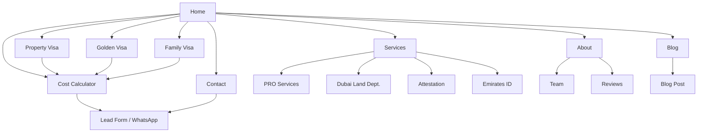
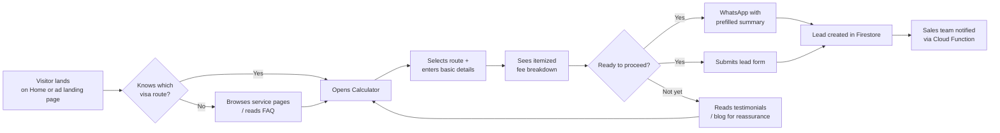
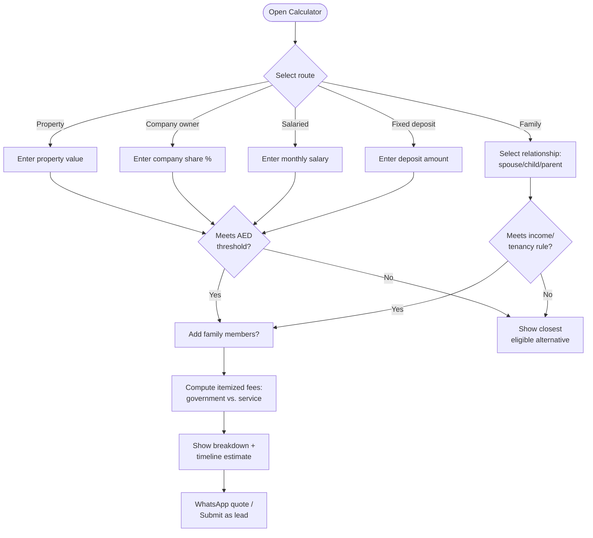
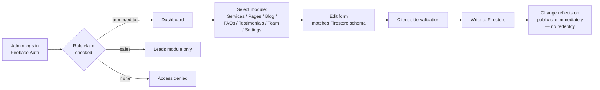
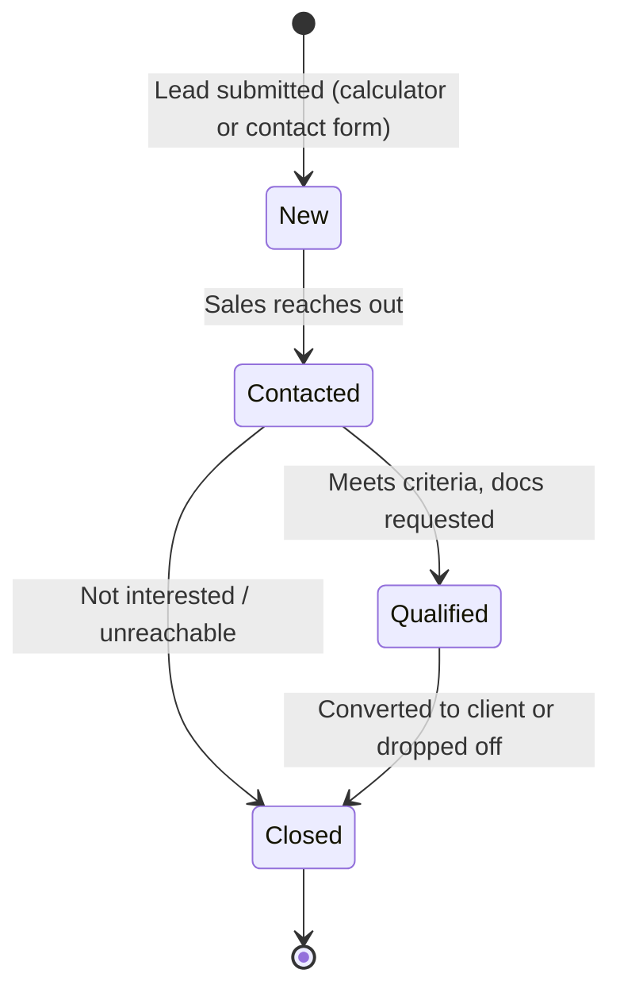

# Web Flow — Site Navigation, User Journeys & Data Flow

**Companion to PRD v1.0 / TRD v1.0 / UI Spec v1.0**

---

## 1. Site Navigation Map

## 2. Visitor Conversion Funnel

## 3. Eligibility Calculator — Decision Flow

## 4. Admin CMS — Content Flow

## 5. Lead Lifecycle

---

## Notes

- Every arrow into "Lead created" corresponds to a `leads` Firestore write (TRD §4) and triggers `onLeadCreated` (TRD §7).
- The calculator decision flow (§3) is the literal logic to implement in `useCalculator` (TRD §8, §10) — route selection drives which `calculatorRules/{route}` document is fetched.
- The admin flow (§4) assumes role claims per TRD §6; a `sales` role should only ever reach the Leads module, never content modules.